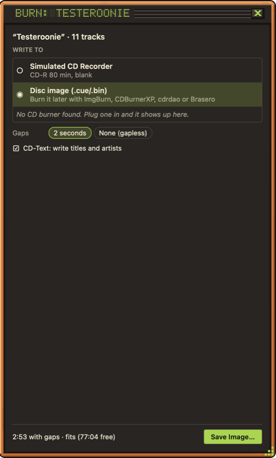

With a [playlist](../playlists/) showing, click **Burn CD…** to burn it to an audio CD that plays in any CD player, car stereo included.

## Setting up the burn

The burn panel opens under the library. Choose:

- **Write to**: your CD writer, with what's in it (a blank CD-R, a CD-RW that needs erasing first, no disc).
- **Speed**: the drive's maximum by default.
- **Gaps**: 2 seconds between tracks, or none for gapless albums and live sets.
- **CD-Text**: writes the playlist name as the album, and each track's title and artist, for players that show them.
- **Test write**: runs everything except the laser, to check a disc would burn fine. It's offered where the drive and OS support it.

Then press **Burn**.

## While it burns

The panel shows each track's progress, the total, the write speed, the drive's buffer where the OS reports it, and a log you can save. Your computer is kept awake until it's done.

> **Tip:** A CD-R stopped part way can't be used again, so Sound Scraper asks before it cancels a burn.

## No CD writer?

Without a CD writer, the button reads **Save CD Image…** and writes the playlist as a `.cue`/`.bin` disc image instead. You can burn it later with ImgBurn, CDBurnerXP, cdrdao or Brasero. Plug in a USB burner and the button changes back.

CD burning isn't available on Linux yet; saving a disc image is.
