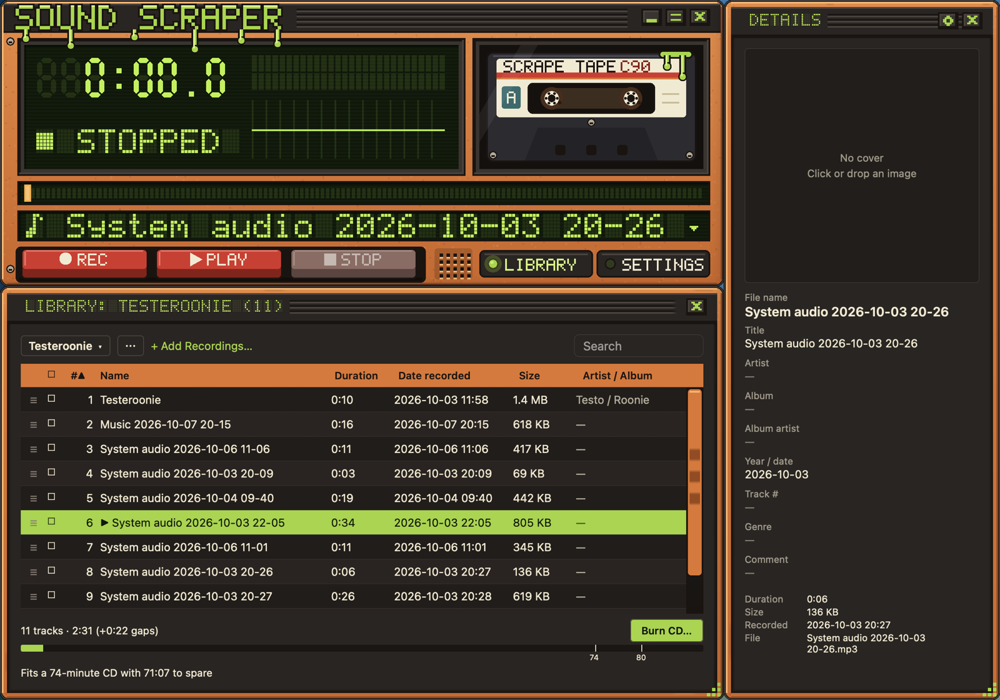

Here's the whole thing in four steps. [Recording](../recording/) goes deeper.

1. Click the **source display** under the seek bar (the line with the ▾) and pick **All system audio**, or an app that's playing sound.
2. Press **REC**. The clock starts counting, and the visualizer and level meters follow the audio.
3. Press **STOP** when you're done.
4. Your recording appears in the library as an MP3, saved in `~/Music/Sound Scraper` (on Windows, `Music\Sound Scraper`).

## Allow System Audio Recording on macOS

The first time you record, macOS asks whether Sound Scraper may record system audio. Choose **Allow**.

Without it, the recording stays silent, and Sound Scraper tells you that no audio arrived. You can change your answer later in **System Settings › Privacy & Security › Screen & System Audio Recording**.

> **Tip:** Windows and Linux don't ask. Recording works straight away.

## What's next

- Tidy up the name and tags in the [library](../library/).
- Recorded a whole album? [Split it into tracks](../track-editor/).
- Make it look like a 70s receiver with a [skin](../skins/).
