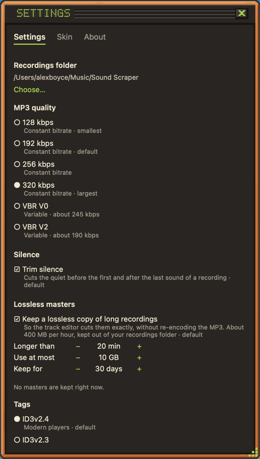

Click **SETTINGS** on the main panel.

## Recordings folder

Where new recordings go and what the library shows. The default is `~/Music/Sound Scraper` (on Windows, `Music\Sound Scraper`). Playlists stay when you switch folders.

## MP3 quality

| Choice   | What it is                       |
| -------- | -------------------------------- |
| 128 kbps | Constant bitrate, smallest files |
| 192 kbps | Constant bitrate, the default    |
| 256 kbps | Constant bitrate                 |
| 320 kbps | Constant bitrate, largest files  |
| VBR V0   | Variable, about 245 kbps         |
| VBR V2   | Variable, about 190 kbps         |

## Silence

**Trim silence** cuts the quiet before the first and after the last sound of a recording. On by default.

## Tags

The default ID3 version for new recordings: **ID3v2.4** for modern players, or **ID3v2.3** for older players, car stereos and Windows (which only shows cover art from v2.3). The default is v2.4 on macOS and Linux and v2.3 on Windows. See [Editing tags](../tags/).

## Now playing

**Tag recordings from now playing** and **Split at track changes**, both on by default. See [Now playing](../now-playing/).

## Lossless masters

**Keep a lossless copy of long recordings** so the [track editor](../track-editor/) cuts them exactly. Choose how long a recording must be (20 minutes by default), how long masters are kept (30 days) and how much disk they may use (10 GB). **Delete all masters…** frees the space at once.

## Skin and About

The **Skin** tab switches and installs [skins](../skins/). **About** shows the version and lists the open-source components Sound Scraper uses.
