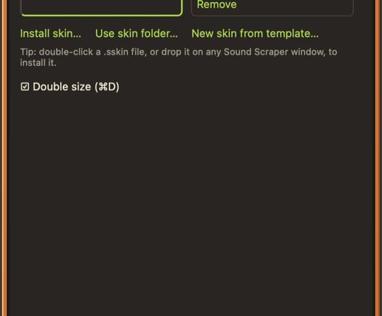

The whole player is skinnable. Sound Scraper comes with the **Default** skin, and more, like **Hi-Fi '74**, are on the [downloads page](../../download/#skins).

## Installing a skin

Skins are `.sskin` files. To install one, do any of these:

- Double-click the `.sskin` file.
- Drop it on any Sound Scraper window.
- Open **SETTINGS › Skin** and choose **Install skin…**.

Switch skins any time in **SETTINGS › Skin**. Anything a skin leaves out falls back to the Default skin.

## Panels

The main panel, library, details, settings, track editor and burn panel are separate windows that snap together.

- Drag a panel by its title bar. Panels snap to each other and dock; dragging the main panel moves everything docked to it. Hold <kbd>Option</kbd> on macOS to drag one freely.
- Double-click a title bar for the one-line **shade** mode.
- **Window › Double Size** (<kbd>⌘</kbd>+<kbd>D</kbd> on macOS) draws the player at twice the size.
- Click the visualizer to cycle its styles.

On Linux, the panels dock on one monitor, and <kbd>Ctrl</kbd>+<kbd>Shift</kbd>+<kbd>M</kbd> moves them to the next.

## Make your own

A skin is a folder of PNGs and a `skin.json` file, zipped. [Making a skin](../making-a-skin/) walks you through it.
