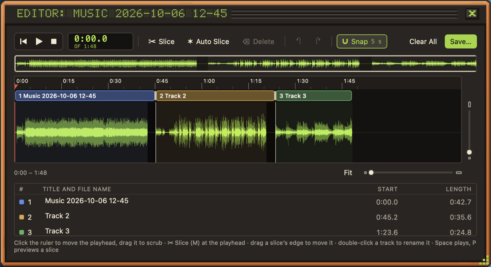

A long recording, like a whole album or a radio show, can be cut into separate tracks in the track editor. Choose **Edit Track…** from a recording's right-click menu or the details panel's gear menu.

## Find your place

- Press <kbd>Space</kbd> to play and pause.
- Click the time ruler to move the playhead, or drag along it to hear where you are.
- Zoom with the sliders around the waveform, and press **Fit** to see the whole recording.
- Toggle **Snap** to snap slices to the ruler.

## Slice it

Press **Slice** or <kbd>M</kbd> at the playhead to start a new track there. Drag a slice's edge to move it, and double-click a track to name it. The name becomes both the title and the file name.

> **Auto Slice** finds the gaps between songs for you. Pick a preset, **Digital** or **Vinyl / Radio**, or tune the silence level and lengths yourself. Check the proposed slices, then press **Add Slices**.

If [now playing](../now-playing/) saw the songs change while you recorded, the slices are already there, named and tagged.

## Cut out the junk

Drag across the waveform to select a stretch you don't want (an ad, a DJ talking, dead air), then press **Delete**. Click a deleted stretch to **Restore** it. Undo and redo work as usual.

## Save

Nothing changes until you press **Save…**, which asks whether to keep the original recording: **Yes, keep it** or **No, delete it**.

- The new tracks keep all of the original's tags except the title, and are numbered 1/N to N/N.
- Cuts are made without re-encoding, so the tracks sound exactly like the original. Only a track with a deleted stretch inside it is re-encoded.
- The new tracks land in the library next to the original.

## Lossless masters

For long recordings, Sound Scraper can keep a lossless copy while recording, so every cut lands exactly where you put it. It's on by default for recordings longer than 20 minutes, takes about 400 MB per hour, and is kept out of your recordings folder. [Settings](../settings/) chooses which recordings get one, how long masters are kept and how much disk they may use.
